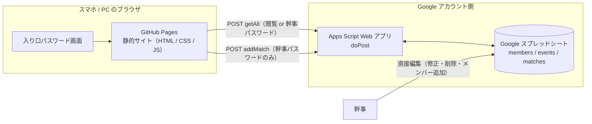

# H vs M テニス交流戦 戦績アプリ 全体設計

作成日：2026-11-06
状態：確認事項は 2026-11-06 にすべて決定済み（§13）。実装（フェーズ 1）に入れる状態。

---

## 1. 何を作るか

H チームと M チームのテニス交流戦（ダブルスのみ）の試合結果をスマホから入力し、
**チーム対抗の戦績** と **個人ごとの対戦成績** をいつでも見られる Web アプリ。

### 試合ルール（固定）

| 項目 | 内容 |
|---|---|
| 種目 | ダブルスのみ。H のペア vs M のペア |
| 形式 | 6 ゲーム先取、ノーアド |
| 引き分け | 5-5 で終了＝引き分け |
| 取りうるスコア | 6-0 / 6-1 / 6-2 / 6-3 / 6-4（どちらが 6 でも可）、5-5（引き分け） |

※ 6-5 や 7-5 は存在しない。時間切れなどの途中終了もない。入力時にこのルールで弾く。

### 必須機能

1. 試合結果の入力（対戦ペア 4 人 ＋ ゲームスコア）。入力できるのは幹事だけ
2. H vs M のチーム戦績（勝・負・分、取得ゲーム数、開催回ごとの内訳）
3. 個人ごとの成績（試合数、勝・負・分、勝率、取得／失ゲーム）
4. 個人の対戦相手別・パートナー別の成績（誰に強い／誰と組むと勝てる）
5. 試合一覧（履歴）
6. 入り口パスワード。閲覧用と幹事用の 2 種類があり、幹事用で入ると入力もできる

### 決まっている前提（§13 で確認済み）

- 1 試合は必ず「H の 2 人 vs M の 2 人」。H と M の混成ペアは作らない。
- 交流戦は複数回開催される（第 1 回、第 2 回…）ので「開催回」を持つ。過去の開催分も遡って登録する。
- 入力は幹事のみ。幹事用パスワードが入力権限を兼ねる。
- 修正・削除は幹事がスプレッドシートを直接編集する（初期版では UI を作らない）。

---

## 2. 全体構成



### 役割分担

| 層 | 使うもの | 役割 | 費用 |
|---|---|---|---|
| 画面 | GitHub Pages | 入力画面・集計画面を配信する静的サイト。ビルド不要の素の HTML/JS | 無料 |
| API | Google Apps Script（GAS）Web アプリ | スプレッドシートの読み書きを HTTP で受ける窓口。パスワード検証とスコア検証もここで行う | 無料 |
| データ | Google スプレッドシート | 唯一のデータ保管場所（source of truth）。幹事はここを直接見て直せる | 無料 |

### なぜこの構成か

- GitHub Pages は静的ファイルしか置けないので、書き込み先が別途必要。スプレッドシートがその役。
- ブラウザから直接スプレッドシートに書くには Google 認証が要り、公開ページでは扱いづらい。
  GAS を間に挟むと「URL に POST するだけ」で読み書きできるようになる。
- **パスワード検証は GAS 側で行う。** 静的サイトの HTML/JS は誰でも読めるので、そこにパスワードを書いても守れない。
  データは GAS からしか出てこないため、GAS がパスワードを確かめれば「HTML は公開、データは非公開」が成り立つ。
- 集計はデータ量が小さい（年間でも数百試合）ので、ブラウザ側の JS でその場で計算する。
  GAS は生データを返すだけにして単純に保つ。

---

## 3. データ設計（スプレッドシート）

1 つのスプレッドシートに 3 シート。

### 3.1 `members` シート

| 列 | 例 | 説明 |
|---|---|---|
| member_id | H01 | 主キー。チーム頭文字＋連番。表示名ではなくこの ID で試合を記録する |
| team | H | H または M |
| name | 山田 | 姓。実名はスプレッドシートにだけ置く（この文書やリポジトリには書かない） |
| display_name | 山田(H) | 画面表示用。同姓がいる場合だけ (H)/(M) を付ける |
| active | TRUE | FALSE にすると入力画面の候補から消える（退会・休会用） |

初期データは 25 名（H 11 名、M 14 名）。member_id は H01〜H11、M01〜M14 を使う。
同じ姓の人が H・M の両方にいるので、その 2 人だけ display_name を「山田(H)」「山田(M)」のように区別する。
実名の一覧は `SECRETS.local.md`（git 管理外）とスプレッドシートの members シートにある。
`setup()` はダミー名（H選手1 …）で 25 行を作るので、シート上で実名に書き換える。

### 3.2 `events` シート（開催回）

| 列 | 例 | 説明 |
|---|---|---|
| event_id | E001 | 主キー |
| date | 2026-11-15 | 開催日 |
| title | 第1回交流戦 | 表示名 |
| venue | ○○テニスコート | 任意 |
| note | | 任意 |

入力画面では「最新の開催回」が初期選択される。開催回の追加は幹事がシートに行を足す。
過去の開催分も 1 回ごとに 1 行作り、その回の試合を matches に入れる。

### 3.3 `matches` シート（試合結果）

| 列 | 例 | 説明 |
|---|---|---|
| match_id | 1 | 連番。GAS が採番（過去分を手入力するときは幹事が付ける） |
| event_id | E001 | どの開催回か |
| date | 2026-11-15 | 試合日（通常は開催日と同じ） |
| h_p1 | H01 | H 側ペア 1 人目（member_id） |
| h_p2 | H02 | H 側ペア 2 人目 |
| m_p1 | M01 | M 側ペア 1 人目 |
| m_p2 | M03 | M 側ペア 2 人目 |
| h_games | 6 | H の取得ゲーム |
| m_games | 3 | M の取得ゲーム |
| result | H | H / M / D（引き分け）。GAS が書き込み時に算出 |
| entered_at | 2026-11-15 14:02 | 入力日時（GAS が付与） |
| entered_by | 山田 | 入力者名（任意、自由入力） |
| note | | メモ（任意） |
| deleted | | TRUE を入れると集計から除外（物理削除せずに取り消せる） |

**ポイント**

- 名前ではなく member_id で記録する。表示名の変更や同姓の問題に強い。
- `result` は冗長だが、シート上で人が見ても分かるように持つ。
- `deleted` 列で論理削除。誤入力の取り消しは幹事がこの列に TRUE を入れるだけ。

---

## 4. API 設計（GAS Web アプリ）

GAS を「ウェブアプリ」としてデプロイ（実行ユーザー：自分、アクセス：全員）。
発行された URL を静的サイト側の `config.js` に書く。

### 4.1 共通ルール

- **すべて POST**。本文は JSON 文字列で、`action` と `key`（パスワード）を必ず含める。
- パスワードを URL のクエリに載せない（ブラウザ履歴やアクセスログに残るため）。読み取りも POST にする理由はこれ。
- 応答は `{ "ok": true, ... }` または `{ "ok": false, "error": "..." }`。
- `error` が `"auth"` のときはパスワード不一致。画面側は保存していたパスワードを消して入り口画面に戻す。
- GAS 側はパスワードから役割を決める。閲覧用 → `viewer`、幹事用 → `admin`。

### 4.2 読み取り：`getAll`

```json
{ "action": "getAll", "key": "<閲覧用 or 幹事用パスワード>" }
```

```json
{
  "ok": true,
  "role": "viewer",
  "members": [ { "member_id": "H01", "team": "H", "name": "H選手1", "display_name": "H選手1", "active": true }, ... ],
  "events":  [ { "event_id": "E001", "date": "2026-11-15", "title": "第1回交流戦" }, ... ],
  "matches": [ { "match_id": 1, "event_id": "E001", "date": "2026-11-15",
                 "h_p1": "H01", "h_p2": "H02", "m_p1": "M01", "m_p2": "M03",
                 "h_games": 6, "m_games": 3, "result": "H", "note": "" }, ... ]
}
```

- 入り口画面はこの 1 本でパスワード確認とデータ取得を兼ねる（成功したら `role` を覚える）。
- `deleted = TRUE` の行は返さない。
- 集計は返さない。ブラウザ側で計算する。

### 4.3 書き込み：`addMatch`（幹事用パスワードのみ）

```json
{
  "action": "addMatch",
  "key": "<幹事用パスワード>",
  "match": {
    "event_id": "E001",
    "h_p1": "H01", "h_p2": "H02",
    "m_p1": "M01", "m_p2": "M03",
    "h_games": 6, "m_games": 3,
    "entered_by": "山田",
    "note": ""
  }
}
```

応答：`{ "ok": true, "match_id": 12 }` または `{ "ok": false, "error": "スコアが不正です" }`

### 4.4 GAS 側で必ず行う検証

| チェック | 内容 |
|---|---|
| パスワード | スクリプトプロパティ `VIEWER_PASS` / `ADMIN_PASS` のどちらかと一致するか。`addMatch` は `ADMIN_PASS` のみ受け付ける |
| 開催回 | event_id が events シートに存在するか |
| メンバー | 4 人全員が members に存在し、h_* は team=H、m_* は team=M か |
| 重複 | h_p1≠h_p2、m_p1≠m_p2 |
| スコア | (6, 0〜4) か (0〜4, 6) か (5, 5) のいずれかのみ |

### 4.5 実装上の注意

- パスワードの実値は **スクリプトプロパティにだけ** 置く。Code.gs にも HTML/JS にも書かない。
- `LockService` で書き込みを直列化する（複数コートから同時送信されても連番が壊れない）。
- ブラウザからの `fetch` は **Content-Type を付けない**（text/plain 扱い）。
  JSON 指定するとプリフライト（OPTIONS）が飛び、GAS はそれに応答できず失敗する。
- GAS の POST 応答は 302 リダイレクトを経由するが、`fetch` が自動で追うのでそのまま使える。
- GAS の応答は `ContentService.createTextOutput(JSON.stringify(...)).setMimeType(JSON)`。
- 応答に 1〜3 秒かかるのが普通。画面側に送信中表示を出す。

---

## 5. 画面設計（GitHub Pages）

スマホ縦画面を基準に作る（コート脇で入力するため）。入り口 ＋ 4 画面。

### 5.0 入り口（パスワード）

- 全ページ共通の `auth.js` が、ページ表示時に `localStorage` にパスワードがあるか確認する。
  なければ画面全体にパスワード入力フォームを出し、他の内容は出さない。
- 入力されたパスワードで `getAll` を呼び、成功したらパスワードと `role` を `localStorage` に保存して本来のページを描画する。失敗したら「パスワードが違います」。
- 一度入れれば同じ端末では再入力不要。「ログアウト」リンクで消せる。
- `role = admin` のときだけナビに「入力」が出る。閲覧用で `input.html` を直接開いても入り口に戻す（GAS 側でも拒否するので二重に守られる）。

### 5.1 `input.html` 試合結果入力（幹事のみ）

```
┌──────────────────────────┐
│ 開催回 [第1回交流戦 ▼]       │
│                            │
│ H ペア                      │
│  [H選手1 ▼]  [H選手2 ▼]      │
│ M ペア                      │
│  [M選手1 ▼]  [M選手3 ▼]      │
│                            │
│ スコア                      │
│  H が勝ち: [6-0][6-1][6-2][6-3][6-4] │
│  M が勝ち: [0-6][1-6][2-6][3-6][4-6] │
│  引き分け: [5-5]             │
│                            │
│ H選手1/H選手2 6-3 M選手1/M選手3 │
│ → H の勝ち                  │
│                            │
│ 入力者 [山田     ]           │
│         [ 送信 ]            │
└──────────────────────────┘
```

- スコアはボタン選択（取りうる 11 通りだけ）。数値入力にしない＝不正スコアが入らない。
- 選択済みの人は相方の候補から消す。
- 送信前に確認文を表示。送信後は開催回・入力者を保持したまま「次の試合を入力」できる。
- 入力者名は `localStorage` に覚えておく。パスワード欄は不要（入り口で入れた幹事用パスワードを使う）。

### 5.2 `index.html` ダッシュボード（チーム戦績）

- 見出し：**H 12 勝 – 9 勝 M（引き分け 2）** のような大きな表示
- 取得ゲーム合計（H 合計 / M 合計）
- 開催回ごとの内訳表（回・日付・H 勝・M 勝・分）
- 直近の試合 5 件
- 他画面へのリンク

### 5.3 `players.html` 個人成績

- 全員の一覧表（チーム / 名前 / 試合数 / 勝 / 負 / 分 / 勝率 / 取得G / 失G）。列見出しタップで並べ替え。チームで絞り込み。
- 名前をタップ → 詳細
  - 対戦相手別：相手ごとの 勝・負・分
  - パートナー別：相方ごとの 勝・負・分
  - 出場試合一覧

### 5.4 `matches.html` 試合一覧

- 全試合を新しい順に。開催回・選手で絞り込み。
- 各行：日付 / H ペア / スコア / M ペア / 結果。

---

## 6. 集計ロジックの定義（JS で実装）

すべて `matches`（deleted 除外）から計算する。

| 指標 | 定義 |
|---|---|
| チーム勝敗 | result が H / M / D の件数 |
| チーム取得ゲーム | h_games 合計、m_games 合計 |
| 個人の試合数 | その member_id が h_p1〜m_p2 のどれかに出現する試合数 |
| 個人の勝・負・分 | 自分のチームが勝った／負けた／引き分けた試合数 |
| 個人の勝率 | **勝 ÷ 試合数**（引き分けも分母に含める）。0 試合なら「–」 |
| 個人の取得G / 失G | 自分のチーム側の games 合計 / 相手側の合計 |
| 対戦相手別 | 自分と相手が別チームで同じ試合に出た件数を、勝・負・分で集計 |
| パートナー別 | 自分と相方が同じチーム側で同じ試合に出た件数を、勝・負・分で集計 |
| ペア成績（発展） | (A, B) の組を 1 単位として勝・負・分 |

---

## 7. 運用ルール

| 項目 | 方針 |
|---|---|
| 閲覧 | 閲覧用パスワードを知っている人。実値は `SECRETS.local.md`（git 管理外）にあり、GAS のスクリプトプロパティ `VIEWER_PASS` に設定する |
| 入力 | 幹事のみ。幹事用パスワード（`ADMIN_PASS`）で入り口を通ると入力画面が使える |
| パスワード変更 | GAS のスクリプトプロパティを書き換えるだけ。サイトの再デプロイは不要 |
| 修正・削除 | 幹事がスプレッドシートを直接編集（deleted 列に TRUE、またはスコア修正）。反映は次回読み込み時 |
| メンバー追加 | members シートに行を追加するだけ |
| 開催回の追加 | events シートに行を追加するだけ |
| 過去分の登録 | 幹事から受け取った結果をもとに events と matches に直接入れる |
| 公開範囲 | HTML/JS は URL を知れば誰でも取得できるが、データはパスワードなしでは出てこない。スプレッドシート自体は非公開のまま |
| バックアップ | スプレッドシートの版履歴に任せる |

---

## 8. リポジトリ構成（案）

```
tennis-hm/
├── docs/                 ← GitHub Pages の公開ディレクトリ
│   ├── index.html        ダッシュボード
│   ├── input.html        試合結果入力（幹事のみ）
│   ├── players.html      個人成績
│   ├── matches.html      試合一覧
│   ├── css/style.css
│   └── js/
│       ├── config.js     GAS の URL（ここだけ環境依存）
│       ├── auth.js       入り口パスワード・role の保持（§5.0）
│       ├── api.js        fetch ラッパー（getAll / addMatch）
│       ├── stats.js      集計ロジック（§6）
│       └── ui.js         画面描画の共通処理
├── gas/
│   └── Code.gs           Apps Script 本体（手動コピーで Apps Script エディタに貼る）
├── .gitignore            SECRETS.local.md を除外
├── SECRETS.local.md      パスワードの実値（git に入れない）
├── DESIGN.md             この文書
└── README.md             セットアップ手順
```

- フレームワークもビルドも使わない。ファイルをそのまま push すれば公開される。
- GitHub の Settings → Pages で「main ブランチの /docs」を指定する。
- GitHub の無料プランでは Pages を使うリポジトリは公開になる。パスワードや GAS の内部情報はコミットしない。

---

## 9. 実装ステップ

### フェーズ 1：動く最小構成（MVP）

1. 過去の交流戦の結果を幹事から受け取る（開催日、ペア 4 人、スコア）。開催回の一覧を確定する
2. スプレッドシートを作成し、3 シートに members 25 名・events・過去分の matches を入れる
3. `Code.gs` を書く（doPost: getAll / addMatch、検証、LockService）。スクリプトプロパティに `VIEWER_PASS` / `ADMIN_PASS` を設定し、Web アプリとしてデプロイ
4. `auth.js` と `input.html` を作り、幹事用パスワードで入ってスマホから 1 試合入力できることを確認
5. `index.html` と `players.html` を作る（チーム戦績・個人の勝敗表まで）
6. GitHub リポジトリに push し、Pages を有効化。実機で確認（閲覧用パスワードでは「入力」が出ないことも確認）

### フェーズ 2：見る側の充実

- 個人詳細（対戦相手別・パートナー別）
- `matches.html` と絞り込み
- 開催回ごとの内訳

### フェーズ 3：あると便利

- 入力画面からの修正・取り消し
- ペアランキング、グラフ
- ホーム画面に追加できる PWA 化、オフライン時の送信待ち
- CSV エクスポート

---

## 10. 検討して見送った案

| 案 | 見送った理由 |
|---|---|
| Google フォームで入力 | 実装ゼロで済むが、ペア 4 人の選択が面倒で、スコアの不正値や重複を防げない。入力 UI を自作する価値が高い |
| GitHub 上の JSON を直接更新 | ブラウザに GitHub トークンを置くことになり危険 |
| Firebase / Supabase | 機能は十分だが設定が増える。幹事がスプレッドシートで直接見て直せる利点が大きい |
| 集計を GAS 側で行う | データが小さいので不要。GAS を単純に保ちたい |
| スプレッドシートの「ウェブに公開」CSV を読む | 読み取りだけなら GAS 不要になるが、誰でも読めてしまいパスワードの意味がなくなる |
| JS 内でパスワードを照合する | HTML/JS は誰でも読めるので守れない。GAS 側で照合する |

---

## 11. 技術的な補足

- **パスワードの強さ**：共有パスワードなので、知っている人から広まる可能性はある。サークルの戦績という性質上、この程度で十分と判断。漏れたらスクリプトプロパティを書き換えるだけで切り替えられる。
- **GAS のデプロイ更新**：Code.gs を変えたら「新しいデプロイ」ではなく既存デプロイの「バージョンを更新」にする。URL が変わらない。
- **応答が遅い場合**：読み取り結果を `sessionStorage` に 1 分キャッシュしてもよい。
- **同姓対策**：画面には常に display_name を出す。ID はユーザーに見せない。
- **日付**：GAS は Date 型を返すと JST とのズレが出るため、シートの日付列は文字列（YYYY-MM-DD）で統一する。

---

## 12. 用語

| 用語 | 意味 |
|---|---|
| 開催回（event） | 交流戦 1 日分。第 N 回 |
| 試合（match） | ダブルス 1 試合。H ペア vs M ペア |
| 結果（result） | H / M / D |
| 論理削除 | 行を消さずに deleted=TRUE で無効化すること |
| role | パスワードから決まる権限。viewer（閲覧）/ admin（幹事） |

---

## 13. 決定事項（2026-11-06 確認済み）

| # | 論点 | 決定 | 設計への反映 |
|---|---|---|---|
| 1 | 「HとK」の K は M の誤記か | H vs M で正しい | 変更なし |
| 2 | 混成ペアは発生するか | 発生しない | 変更なし（H 2 人 vs M 2 人固定） |
| 3 | 5-5 以外の途中終了はあるか | ない | 変更なし（未完フラグは作らない） |
| 4 | 入力は全員か幹事か | 幹事だけ | PIN 欄を廃止。幹事用パスワードが入力権限を兼ねる |
| 5 | 勝率の定義 | 勝 ÷ 試合数 | §6 を変更（引き分けも分母に含める） |
| 6 | 公開範囲 | 入り口パスワードを設ける。閲覧用と幹事用の 2 種類 | §4・§5.0・§7 を追加。実値は `SECRETS.local.md` と GAS スクリプトプロパティにのみ置く |
| 7 | 過去の結果を遡って入れるか | 入れる | フェーズ 1 の最初に結果を受け取る工程を追加 |

### 実装に入る前に受け取るもの

- 過去の交流戦の結果。1 試合ごとに「開催日 / H のペア 2 人 / M のペア 2 人 / スコア」。
  メモ書きや写真でもよい。こちらで events と matches の形に整える。
