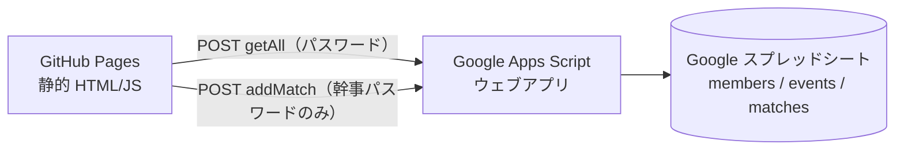

# テニス班 戦績アプリ 全体設計

テニス班の中で行ったシングルスとダブルスの試合結果をため、個人の戦績と対戦成績を見るための Web アプリ。
2026-11-13 に、H チーム対 M チームの交流戦アプリから班内向けに作り替えた（§9）。

---

## 1. 何を作るか

### 試合ルール（固定）

| 項目 | ルール |
|---|---|
| 種目 | シングルス（1 対 1）とダブルス（2 対 2） |
| 形式 | 6 ゲーム先取、ノーアドバンテージ |
| 引き分け | 5-5 で終了し引き分け |
| 取りうるスコア | 6-0〜6-4、0-6〜4-6、5-5 の 11 通り。シングルスも同じ |
| 組み合わせ | だれとでも組め、だれとでも対戦できる。チーム分けはない |

### 必須機能

1. 試合結果（日付、種目、両側の選手、スコア）を入力する。
2. 全体の試合数と、種目別の勝率ランキングを見る。
3. 個人の戦績を種目別に見る。対戦相手別とパートナー別の成績も見る。
4. 試合一覧を種目と選手で絞り込んで見る。

### 決まっている前提

- 入力は幹事だけ。幹事用パスワードが入力権限を兼ねる。
- 入り口にパスワードを設ける。閲覧用と幹事用の 2 種類。実値は `SECRETS.local.md` と GAS のスクリプトプロパティにだけ置く。
- 勝率 = 勝 ÷ 試合数。引き分けも分母に含める。
- 公開リポジトリに実名は置かない。

---

## 2. 全体構成



| 層 | 役割 |
|---|---|
| GitHub Pages | 画面と集計。データは毎回 GAS から全件取り、ブラウザで数える |
| GAS | パスワード照合、入力の検証、シートの読み書き |
| スプレッドシート | データの保管。幹事が直接直すこともある |

---

## 3. データ設計（スプレッドシート）

シートは見出し名で読み書きする。列の並びが違っても動く。

### 3.1 `members`

| 列 | 内容 |
|---|---|
| member_id | 一意の ID。新しい人は `P01`、`P02` … の連番。旧版から引き継いだ人は `H01`、`M01` などのまま |
| name | 名前 |
| display_name | 画面に出す名前。空なら name を使う。同じ名前の人がいるときは区別できるようにする |
| active | `FALSE` にすると入力候補から消える。過去の成績は残る |

初期データは持たない。入力画面で初めての名前が送られたときに行を追加する。
旧版のシートにある `team` 列は使わない。消してもよい。

### 3.2 `matches`

| 列 | 内容 |
|---|---|
| match_id | 連番 |
| date | 試合日（`YYYY-MM-DD`、文字列） |
| type | `S`（シングルス）か `D`（ダブルス）。空欄はダブルス扱い |
| a1, a2 | A 側の member_id。シングルスでは a2 は空 |
| b1, b2 | B 側の member_id。シングルスでは b2 は空 |
| a_games, b_games | ゲーム数 |
| result | `A`（A 側の勝ち）、`B`、`D`（引き分け）。API はゲーム数から計算し直す |
| entered_at, entered_by | 入力日時と入力者 |
| note | メモ |
| deleted | `TRUE` で集計から外す（論理削除） |
| event_id | 旧版の開催回。新しい入力では空 |

A 側と B 側に意味はない。入力した人が左右どちらに書いたかだけを表す。

### 3.3 `events`

旧版の開催回。新しい画面では使わない。残しておいても害はない。

---

## 4. API 設計（GAS ウェブアプリ）

すべて POST。本文は JSON 文字列で、Content-Type は付けない（プリフライトを避けるため）。

| action | 入力 | 出力 |
|---|---|---|
| `getAll` | `key` | `{ ok, role, members, events, matches }`。role は `viewer` か `admin` |
| `addMatch` | `key`（幹事用のみ）、`match` | `{ ok, match_id, ids, created }` |

`match` は `{ type, date, a1, a2, b1, b2, a_games, b_games, entered_by, note }`。
a1〜b2 には member_id か名前を入れる。`ids` は登録した [a1, a2, b1, b2] の member_id、`created` は新しく登録した人。

### 4.1 GAS 側の検証

| 項目 | 内容 |
|---|---|
| パスワード | `VIEWER_PASS` か `ADMIN_PASS` と一致するか。`addMatch` は `ADMIN_PASS` のみ |
| 種目 | `S` か `D` |
| 日付 | `YYYY-MM-DD`。空なら今日 |
| スコア | 11 通りのどれか |
| 選手 | 種目に必要な人数がそろっているか。同じ人が 2 回入っていないか |
| 名前の解決 | 表示名、次に名前で探す。空白・全角半角・大文字小文字の違いは同じ名前とみなす。同名が複数なら拒否。見つからなければ members に追加 |
| 名前の制限 | 20 文字まで。先頭が `=` `+` `-` `@` `'` の名前は数式とみなされるので拒否 |

検証がすべて通ってから members と matches に書く。不正な送信で人が増えないようにする。
書き込みは LockService で直列化し、連番が重ならないようにする。

---

## 5. 画面設計（GitHub Pages）

すべてスマホ縦画面が基準。明暗の両テーマに対応する。

| 画面 | 内容 |
|---|---|
| 入り口 | パスワード入力。通ると端末に覚える |
| `index.html` 戦績 | 総試合数（シングルス／ダブルス別）、今月の試合数、最新の試合日、出場人数。種目別の勝率ランキング。最近の 5 試合 |
| `players.html` 個人 | 種目で絞れる個人成績表（列で並べ替え）。名前を押すと種目別の戦績、対戦相手別、パートナー別（ダブルスを含むとき）、出場試合 |
| `matches.html` 試合 | 種目と選手で絞り込める一覧。選手を選ぶとその人の勝敗も出す |
| `input.html` 入力 | 幹事のみ。日付（初期値は今日）、種目、A 側と B 側の名前、スコアボタン、確認欄 |

入力画面の決まりごと。

- 種目を切り替えると、ダブルスの 2 人目の欄が出たり消えたりする。前回の種目を端末に覚える。
- 名前は自由入力。登録済みの名前は候補に出す。初めての名前は確認欄に「はじめての名前」と出し、入力ミスに気づけるようにする。
- スコアはボタンで選ぶ。数値入力にしないので、ルール外のスコアは入らない。
- 送信後は日付・種目・入力者を残し、名前とスコアだけ消す。

---

## 6. 集計ロジック（`docs/js/stats.js`）

| 指標 | 定義 |
|---|---|
| 試合 | 出場した試合数 |
| 勝・負・分 | その人の側から見た結果 |
| 勝率 | 勝 ÷ 試合。試合 0 なら表示しない |
| 取得 G・失 G | 自分の側と相手側のゲーム数の合計 |
| ランキング | 勝率 → 勝ち数 → 試合数の順に並べる |
| 対戦相手別 | 相手側にいた人ごとの勝敗。ダブルスでは相手 2 人それぞれに 1 試合ずつ数える |
| パートナー別 | ダブルスで同じ側にいた人ごとの勝敗 |

---

## 7. 運用

| やること | 方法 |
|---|---|
| 入力 | 幹事が幹事用パスワードで入り、「入力」から送る |
| 取り消し | `matches` の `deleted` に `TRUE` |
| スコアや選手の修正 | `matches` を直接直す。直したあと `checkMatches()` を実行 |
| 名前の入力ミス | 試合の ID を正しい人に直し、誤って増えた `members` の行を消す |
| 退部 | `members` の `active` を `FALSE` |
| パスワード変更 | スクリプトプロパティを変える。サイトの再公開は不要 |

---

## 8. リポジトリ構成

```
tennis-hm/
├── docs/              GitHub Pages で公開するフォルダ
│   ├── index.html     戦績（ランキング・最近の試合）
│   ├── players.html   個人成績
│   ├── matches.html   試合一覧
│   ├── input.html     試合結果入力（幹事のみ）
│   ├── css/style.css
│   ├── img/           キャラクター画像とアプリアイコン
│   └── js/            config / auth / api / stats / ui / mock
├── gas/Code.gs        Apps Script 本体
├── SECRETS.local.md   パスワードの実値（git に入れない）
├── DESIGN.md
└── README.md
```

---

## 9. 旧版（H vs M 交流戦）からの移行

| 項目 | 内容 |
|---|---|
| matches の見出し | `h_p1` → `a1`、`h_p2` → `a2`、`m_p1` → `b1`、`m_p2` → `b2`、`h_games` → `a_games`、`m_games` → `b_games` |
| 種目 | `type` 列を足し、既存の試合はダブルス（`D`）にする |
| 結果 | `result` を `H` / `M` から `A` / `B` に計算し直す |
| メンバー | ID（H01、M01 など）はそのまま。`team` 列は使わなくなる |
| 実行方法 | 新しい `Code.gs` を貼って `setup()` を実行する。何度実行しても壊れない |

`setup()` を実行するまでは、新しい GAS は送信を受け付けない（種目が記録できないため）。読み取りは旧見出しのままでもできる。
画面側も旧版の GAS の応答を読めるので、GAS と画面の更新順はどちらが先でもよい。

---

## 10. 用語

| 用語 | 意味 |
|---|---|
| A 側・B 側 | 1 試合の両側。左右の区別だけで、チームではない |
| 幹事 | 幹事用パスワードを知っていて入力できる人 |
| 論理削除 | 行を消さずに `deleted` を `TRUE` にして集計から外すこと |
